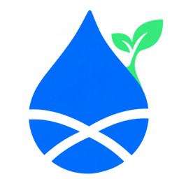
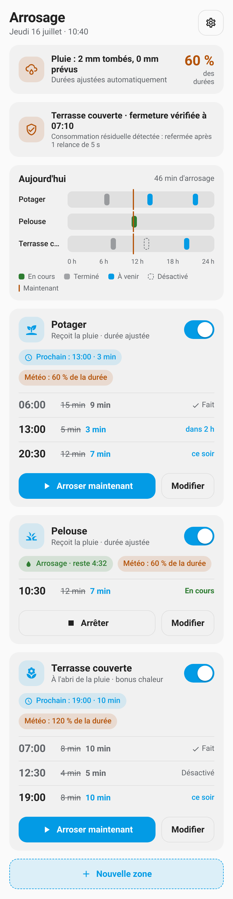
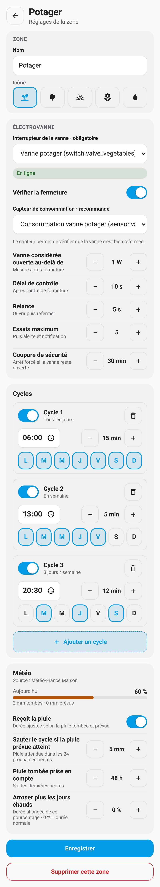
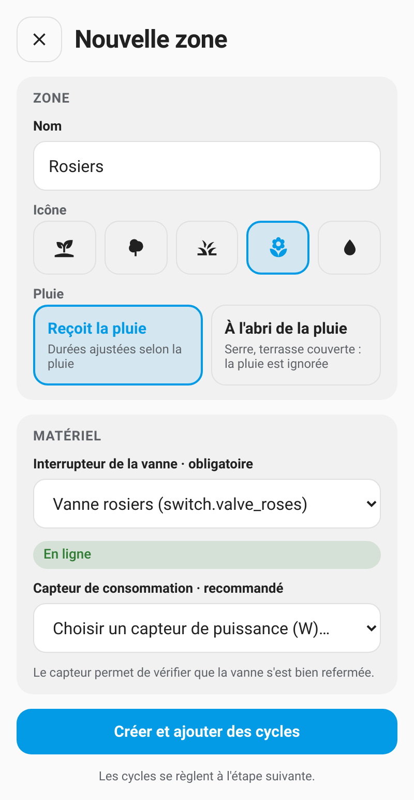
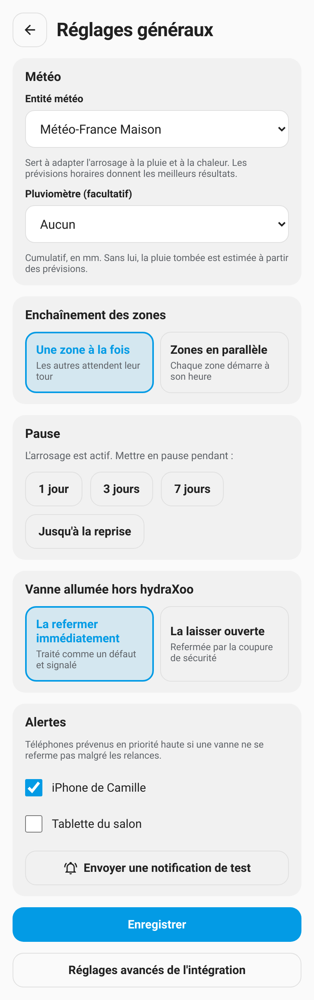

<p align="center"></p>

# hydraXoo

*[English version](README.md)*

Arrosage automatique par zones pour Home Assistant, libre et gratuit. Tout se règle depuis l'interface, avec une carte de tableau de bord pensée pour le téléphone — sans YAML.

- **Zones et cycles** : autant de zones que vous voulez, chacune commandée par une entité `switch` existante (prise Z-Wave, Zigbee, Wi-Fi, relais…), chacune avec autant de cycles que nécessaire (heure, durée, jours).
- **Météo** : durées adaptées à la pluie tombée, à la pluie prévue et à la chaleur ; cycles sautés quand assez de pluie arrive.
- **Sécurité** : coupure après une durée maximale, contrôle de fermeture par la consommation électrique de la prise, alerte sur votre téléphone si une vanne reste ouverte.
- **Carte** : tableau de bord, réglages et création de zones, thèmes clair et sombre, en français, anglais, allemand, espagnol et italien.

<table>
  <tr>
    <td></td>
    <td></td>
    <td></td>
    <td></td>
  </tr>
  <tr>
    <td align="center">Tableau de bord</td>
    <td align="center">Réglages d'une zone</td>
    <td align="center">Nouvelle zone</td>
    <td align="center">Réglages généraux</td>
  </tr>
</table>

## Sommaire

- [Prérequis](#prérequis)
- [Installation](#installation)
- [Premiers pas](#premiers-pas)
- [La carte](#la-carte)
- [Programmation](#programmation)
- [Ajustement météo](#ajustement-météo)
- [Sécurité](#sécurité)
- [Alerte gel](#alerte-gel)
- [Entités, services et événements](#entités-services-et-événements)
- [Exemples d'automatisations](#exemples-dautomatisations)
- [Dépannage](#dépannage)
- [Langues](#langues)
- [Développement](#développement)

## Prérequis

- Home Assistant **2026.3** ou plus récent.
- Une entité `switch` par zone : la prise ou le relais qui alimente l'électrovanne.
- Recommandé : le **capteur de consommation** de la prise (W), pour le contrôle de fermeture.
- Facultatif : une entité **météo** (Met.no, Météo-France ou autre), un **pluviomètre** cumulatif, l'**application Home Assistant** sur votre téléphone pour les alertes.

## Installation

1. Dans Home Assistant, ouvrez **Paramètres › Marketplace**.
2. Choisissez **Add from link**, saisissez `PhilGG/hydraXoo` puis **Add** (une connexion GitHub est demandée la première fois).
3. Ouvrez hydraXoo dans le Marketplace, installez-le, puis **redémarrez Home Assistant**.
4. hydraXoo est en général proposé automatiquement après le redémarrage. Sinon : **Paramètres › Appareils et services › Ajouter une intégration › hydraXoo**.
5. **Rechargez une fois la page du tableau de bord** pour que le navigateur charge la carte.

<details>
<summary>Installation manuelle</summary>

Copiez `custom_components/hydraxoo` depuis la [dernière version](https://github.com/PhilGG/hydraXoo/releases) dans le dossier `custom_components` de votre configuration Home Assistant, puis redémarrez. Les mises à jour seront alors manuelles elles aussi.
</details>

**Mettre à jour** : installez la mise à jour depuis le Marketplace, redémarrez Home Assistant, puis rechargez une fois la page du tableau de bord.

**Désinstaller** : supprimez l'intégration dans **Paramètres › Appareils et services** ; ses zones et son historique sont supprimés avec elle.

## Premiers pas

1. À l'installation, choisissez (tout est facultatif et modifiable ensuite avec le bouton ⚙ de la carte ou dans **Configurer › Réglages généraux**) :
   - l'**entité météo** ;
   - un **capteur de pluie** (pluviomètre cumulatif en mm) ;
   - l'**enchaînement des zones** : *une zone à la fois* (par défaut) ou *zones en parallèle* ;
   - les **téléphones** à prévenir si une vanne ne se referme pas.
2. Ajoutez la carte à un tableau de bord : **Modifier le tableau de bord › Ajouter une carte › Par carte › hydraXoo**.
3. Dans la carte, choisissez **Nouvelle zone** : nom, icône, reçoit la pluie ou non, interrupteur de la vanne, capteur de consommation. **Créer et ajouter des cycles** ouvre ensuite les réglages de la zone pour ajouter ses cycles.

Les zones se gèrent aussi sans la carte, avec le bouton **Configurer** de l'intégration.

## La carte

La carte est servie par l'intégration et ajoutée automatiquement aux ressources du tableau de bord.

```yaml
type: custom:hydraxoo-card
title: Arrosage        # facultatif
compact: false         # facultatif : masque la frise et les listes de cycles
zones: []              # facultatif : identifiants des zones affichées, toutes si vide
```

Ces options existent aussi dans l'éditeur visuel de la carte.

**Tableau de bord**

- Bandeau météo : pluie tombée et prévue, coefficient du jour et sa raison.
- Dernier contrôle de fermeture (par exemple « refermée après 1 relance de 5 s »), bandeaux de défaut et de pause.
- Frise de 24 h : terminé (gris), sauté (hachuré), à venir (bleu), désactivé (pointillé), en cours (vert), heure actuelle.
- Une carte par zone : interrupteur, prochain arrosage, cycles du jour avec la durée de base barrée et la durée ajustée (✓ Fait, ✕ Sauté · pluie, dans 2 h…), **Arroser maintenant** avec une durée au choix, **Arrêter**, **Modifier**.

**Réglages d'une zone** : électrovanne et contrôle de fermeture, coupure de sécurité, cycles (activation, heure, durée −/+, jours, ajout, suppression), météo (reçoit la pluie, règles pluie, bonus chaleur), **Enregistrer**, **Supprimer cette zone**. Les modifications s'appliquent immédiatement, sans rien redémarrer.

**Nouvelle zone** : nom, cinq icônes, reçoit la pluie ou non, interrupteur de la vanne, capteur de consommation.

**Réglages généraux** (bouton ⚙) : entité météo et pluviomètre, enchaînement des zones, pause pendant 1, 3 ou 7 jours ou jusqu'à la reprise, téléphones à prévenir — affichés par leur nom — avec un bouton **Envoyer une notification de test**. Ils s'appliquent immédiatement, sans couper un arrosage en cours. **Réglages avancés de l'intégration** ouvre les écrans de Home Assistant.

La modification et les réglages sont réservés aux administrateurs ; les autres utilisateurs peuvent arroser, arrêter et activer les zones.

Les heures suivent le **format de l'heure** de votre profil (12 ou 24 heures) et les jours suivent son **premier jour de la semaine**. Le champ d'heure d'un cycle est le sélecteur d'heure du navigateur : son format suit la langue de votre navigateur ou de votre téléphone.

## Programmation

- Un cycle démarre à son heure, ses jours, si la zone et le cycle sont actifs, si l'arrosage n'est pas en pause, si la zone n'est pas en défaut et si la météo ne le saute pas.
- **Une zone à la fois** (par défaut) : un arrosage qui tombe pendant qu'une autre zone arrose — ou pendant le contrôle d'une vanne — attend dans une **file d'attente** et démarre dès que la place se libère. C'est aussi le cas d'**Arroser maintenant** et de deux cycles d'une même zone qui se chevauchent. **Zones en parallèle** : chaque zone démarre à son heure.
- **Pause** : l'interrupteur *Pause de l'arrosage*, ou `hydraxoo.pause` avec un nombre de jours (elle se lève alors seule). Les cycles sont sautés pendant la pause ; l'arrosage manuel reste possible et un arrosage en cours n'est pas arrêté. La pause est conservée en cas de redémarrage.
- **Arroser maintenant** utilise la durée choisie (par défaut : celle du premier cycle actif de la zone). L'arrosage manuel n'est jamais ajusté à la météo.
- **Zone désactivée** : ses cycles sont sautés, l'arrosage manuel reste possible.
- **Redémarrage** : la file d'attente est vidée et un cycle interrompu n'est pas relancé ; une vanne trouvée ouverte est fermée puis contrôlée.

## Ajustement météo

Chaque zone a sa propre règle (carte : **Modifier › Météo** ; ou **Configurer › Modifier une zone › Réglages de la zone › Règle météo**). Valeurs par défaut :

| Réglage | Défaut | Signification |
| --- | --- | --- |
| Reçoit la pluie | activé | Désactivé pour une serre ou une zone couverte : la pluie est ignorée |
| Sauter le cycle si la pluie prévue atteint | 5 mm | Sur les 24 prochaines heures ; c'est aussi la quantité de pluie qui remplace un arrosage complet |
| Pluie tombée prise en compte | 48 h | Les dernières 24 h comptent entièrement, les 24 h d'avant pour moitié |
| Arroser plus les jours chauds | +0 % | 0 % = durée normale |
| Jour chaud à partir de | 30 °C | Température maximale prévue dans la journée |
| Coefficient minimum / maximum | 0 % / 150 % | Bornes du résultat |

Le calcul, juste avant chaque départ :

1. **Pluie prévue ≥ seuil** → le cycle est sauté (événement `hydraxoo_cycle_skipped`, raison `weather`).
2. Sinon **coefficient = 1 − (pluie tombée pondérée + pluie prévue) ÷ seuil**, entre 0 et 100 %.
3. **Bonus chaleur** : multiplié par (1 + bonus) les jours chauds.
4. Borné entre le minimum et le maximum ; la durée est arrondie à la minute. 0 minute saute le cycle.

Une zone qui **ne reçoit pas la pluie** ignore les étapes 1 et 2 : seul le bonus chaleur peut changer sa durée.

**Sources**

- **Pluie prévue** et **température** : `weather.get_forecasts`, prévisions horaires si le fournisseur en donne, sinon journalières. Testé avec les formats Met.no et Météo-France ; les heures sans valeur de pluie sont ignorées ; les pouces et les °F sont convertis.
- **Pluie tombée** : lue sur le pluviomètre s'il est renseigné (remises à zéro gérées) ; sinon estimée en enregistrant, chaque heure, la pluie prévue pour cette heure — les entités météo ne donnent pas la pluie réellement tombée.
- **Météo indisponible**, ou fournisseur sans quantité de pluie : 100 % et un avertissement dans la carte et le capteur *Coefficient météo*.

## Sécurité

**Coupure de sécurité** (par zone, 5 min par défaut — à augmenter pour des cycles plus longs) : la vanne est toujours fermée après ce délai, quoi qu'il arrive. Un cycle plus long que la coupure est accepté mais arrêté à la coupure : la carte le signale dans les réglages de la zone (avec un bouton pour augmenter la coupure) et affiche ⚠ à côté de la durée réelle sur le tableau de bord.

**Vanne allumée hors hydraXoo** : les vannes ne devraient être ouvertes que par hydraXoo. Par défaut, une telle ouverture est **refermée immédiatement**, contrôlée, signalée sur la carte (« ouverture non commandée à 10:42 ») et envoyée aux téléphones choisis (au plus une alerte par zone toutes les 10 minutes ; événement `hydraxoo_unexpected_open`). Si vous vous servez volontairement du bouton de la prise, choisissez *La laisser ouverte* dans les **Réglages généraux** : la vanne reste alors ouverte jusqu'à la coupure de sécurité, avec un compte à rebours et un bouton Arrêter sur la carte.

**Contrôle de fermeture** — actif quand la zone a un capteur de consommation. Une électrovanne ouverte consomme de l'électricité ; après chaque fermeture, hydraXoo :

1. attend le **délai de contrôle** (10 s), puis lit la consommation ;
2. au **seuil** ou en dessous (1 W) : fermée ;
3. au-dessus : rallume la vanne pendant la durée de **relance** (5 s), l'éteint, et revient à l'étape 1 ;
4. après le **nombre maximal de relances** (5) : la zone passe en **défaut**.

Une zone en défaut n'arrose plus jusqu'à l'acquittement (bouton de la carte ou `hydraxoo.acknowledge_fault`). Une notification s'affiche dans Home Assistant et, si des téléphones sont choisis dans les **Réglages généraux › Alertes** de la carte (ou **Configurer › Réglages généraux › Notifications sur mobile**), une alerte en priorité haute leur est envoyée (retirée à l'acquittement).

Le contrôle a lieu après chaque fermeture (fin d'arrosage, Arrêter, coupure, vanne éteinte à la main), au démarrage, et **à tout moment** si une prise éteinte se met à consommer — vanne bloquée, ou prise revenue en ligne après un redémarrage. Une prise allumée exprès n'est pas touchée (la coupure de sécurité s'applique toujours).

**Régler la prise** : beaucoup de prises ne transmettent leur consommation qu'à intervalles réguliers ou au-delà d'une variation minimale (par exemple toutes les 60 s ou ±5 W). Si la mesure lue après la fermeture date d'avant l'ordre de fermeture, hydraXoo attend jusqu'à 60 s une mesure récente. Pour un contrôle fiable :

1. Dans les réglages de la prise (Z-Wave JS : configuration de l'appareil), réduisez autant que possible l'**intervalle de rapport** de la consommation et la **variation minimale**.
2. Choisissez un **délai de contrôle** un peu plus long que l'intervalle de rapport de la prise.
3. Réglez le **seuil** entre la consommation propre de la prise au repos et celle de la vanne (une électrovanne consomme en général 2 à 8 W ; le seuil descend jusqu'à 0,1 W).

Si le capteur de consommation est indisponible, la fermeture n'est pas contrôlée (pas de relance) et un avertissement est écrit dans le journal.

## Alerte gel

Une canalisation extérieure peut éclater en gelant. Quand la prévision des 24 prochaines heures descend à **2 °C ou moins** (seuil réglable ; °F gérés) alors que des cycles sont programmés, hydraXoo rappelle de couper les circuits d'eau extérieurs — sans harceler :

- Un **épisode de gel** commence à la première prévision sous le seuil et ne se termine qu'au redoux franc (seuil + 2 °C) : une prévision qui oscille autour du seuil ne relance pas l'alerte.
- **Au plus deux notifications par épisode** : l'alerte à la détection (reportée à 7 h si elle tombe la nuit et que le gel n'est pas attendu avant 10 h), puis **un seul rappel environ 3 heures avant le gel** si personne n'a confirmé — et seulement s'il tombe au moins 2 heures après l'alerte.
- **Confirmer** avec les boutons **C'est fait** ou **Mettre l'arrosage en pause** de la notification, ou depuis le bandeau gel de la carte. Mettre l'arrosage en pause, ou ne plus avoir de cycle actif dans les zones concernées, vaut aussi confirmation. Ensuite, plus rien jusqu'au redoux.
- L'épisode est enregistré : un redémarrage ne renvoie jamais l'alerte. Événement `hydraxoo_frost_warning` (`kind` : `alert`, `reminder`, `thaw`).
- **Message de fin de gel** facultatif (désactivé par défaut), avec un bouton **Reprendre l'arrosage** si l'arrosage est en pause.
- Par zone, l'**Alerte gel** peut être désactivée (par exemple une serre chauffée) : cette zone ne compte plus.

Réglages : carte **⚙ › Gel** (ou **Configurer › Réglages généraux**). Nécessite une entité météo ; les alertes partent vers les téléphones choisis dans **Alertes**.

## Entités, services et événements

Entités générales (appareil **hydraXoo**) :

| Entité | Type | Rôle |
| --- | --- | --- |
| Pause de l'arrosage | `switch` | Allumé, aucun cycle ne démarre ; attribut `until` quand la pause se lève seule |
| File d'attente | `sensor` | Nombre d'arrosages en attente, listés dans l'attribut `items` |

Par zone (un appareil par zone) :

| Entité | Type | Rôle |
| --- | --- | --- |
| Zone active | `switch` | Éteint, les cycles de la zone sont sautés |
| Arrosage en cours | `binary_sensor` | Allumé tant que hydraXoo garde la vanne ouverte |
| Défaut de fermeture | `binary_sensor` (problème) | Allumé quand la vanne n'a pas pu être refermée ; dernier contrôle en attributs |
| Prochain arrosage | `sensor` (horodatage) | Prochain départ ; durée de base et durée ajustée en attributs |
| Temps restant | `sensor` (durée) | Temps restant de l'arrosage en cours |
| Coefficient météo | `sensor` (%) | Pourcentage appliqué à la durée de base ; pluie tombée, pluie prévue, température et avertissements en attributs |

Services :

| Service | Champs |
| --- | --- |
| `hydraxoo.run_zone` | `zone` (appareil), `duration` (minutes, facultatif) |
| `hydraxoo.stop_zone` | `zone` (appareil) |
| `hydraxoo.stop_all` | — (vide aussi la file d'attente) |
| `hydraxoo.pause` | `days` (facultatif ; vide = jusqu'à la reprise) |
| `hydraxoo.resume` | — |
| `hydraxoo.acknowledge_fault` | `zone` (appareil) |

Événements :

| Événement | Données |
| --- | --- |
| `hydraxoo_cycle_started` | `zone_id`, `zone_name`, `source` (`schedule` / `manual`), `duration_min`, `cycle_id` ; pour les cycles, aussi `base_duration_min`, `coefficient_pct` |
| `hydraxoo_cycle_finished` | `zone_id`, `zone_name`, `reason` (`completed`, `manual_stop`, `max_runtime`, `external`, `restart`, `unload`), `source`, `duration_min`, `elapsed_min` |
| `hydraxoo_cycle_skipped` | `zone_id`, `zone_name`, `cycle_id`, `reason` (`weather`, `paused`, `zone_disabled`, `fault`, `stopped`), `weather` (détails) |
| `hydraxoo_safety_retry` | `zone_id`, `zone_name`, `attempt`, `max_attempts`, `power_w` |
| `hydraxoo_safety_failed` | `zone_id`, `zone_name`, `attempts`, `power_w` |
| `hydraxoo_unexpected_open` | `zone_id`, `zone_name` |
| `hydraxoo_frost_warning` | `kind` (`alert`, `reminder`, `thaw`), `min_temp_c`, `frost_at` |

## Exemples d'automatisations

Être prévenu quand la pluie annule un arrosage :

```yaml
alias: Arrosage sauté pour cause de pluie
triggers:
  - trigger: event
    event_type: hydraxoo_cycle_skipped
    event_data:
      reason: weather
actions:
  - action: notify.mobile_app_mon_telephone
    data:
      message: "{{ trigger.event.data.zone_name }} : arrosage sauté, pluie prévue."
```

Tout arrêter si un détecteur de fuite se déclenche, et mettre en pause pour une journée :

```yaml
alias: Fuite - arrêter l'arrosage
triggers:
  - trigger: state
    entity_id: binary_sensor.fuite_jardin
    to: "on"
actions:
  - action: hydraxoo.stop_all
  - action: hydraxoo.pause
    data:
      days: 1
```

## Dépannage

| Symptôme | Que faire |
| --- | --- |
| La carte n'est pas proposée | Dans **Ajouter une carte**, utilisez l'onglet **Par carte**, pas *Par entité*. Rechargez la page ; vérifiez que `/hydraxoo_static/hydraxoo-card.js` figure dans **Paramètres › Tableaux de bord › ⋮ › Ressources**. |
| Anciens textes ou ancienne présentation après une mise à jour | Rechargez la page (sur ordinateur, en forçant : Ctrl/Cmd + Maj + R ; dans l'application : *Paramètres › Application compagnon › Débogage › Réinitialiser le cache du frontend*). |
| Des relances alors que la vanne s'est bien fermée | La prise transmet trop tard : réduisez son intervalle de rapport ou allongez le délai de contrôle. |
| Coefficient météo bloqué à 100 % avec un avertissement | L'entité météo est indisponible, ou le fournisseur ne donne pas de quantité de pluie : essayez un autre fournisseur (Met.no donne des quantités horaires). |
| « — » au lieu de ✓ pour un cycle passé | Aucune trace pour ce cycle (par exemple un cycle passé avant la mise à jour en 0.0.7). |

Journal détaillé :

```yaml
logger:
  logs:
    custom_components.hydraxoo: debug
```

Signalez les problèmes sur [GitHub](https://github.com/PhilGG/hydraXoo/issues).

## Langues

Français, anglais, allemand, espagnol et italien, partout : écrans de configuration, entités, services, notifications et carte. La carte suit la langue de votre profil Home Assistant (anglais sinon). Les traductions sont dans `custom_components/hydraxoo/translations/` et `frontend/src/locales/` ; corrections et nouvelles langues bienvenues.

## Développement

Tout tourne dans Docker ; rien d'autre n'est nécessaire sur votre machine.

```bash
./dev build   # construire l'image de développement
./dev test    # lancer les tests de l'intégration
./dev lint    # vérifier le style du code
./dev card    # vérifier, tester et compiler la carte (Node tourne aussi dans Docker)
./dev screenshots   # refaire les captures du README (Chromium sans interface, dans Docker)
```

Les sources de la carte sont dans `frontend/` (TypeScript + Lit). `custom_components/hydraxoo/frontend/hydraxoo-card.js` est généré par `./dev card` : ne pas le modifier à la main. L'historique des versions est dans [CHANGELOG.md](CHANGELOG.md).

## Licence

[MIT](LICENSE)
