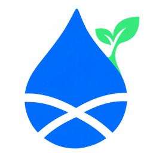
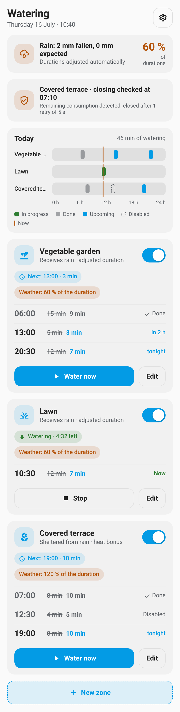
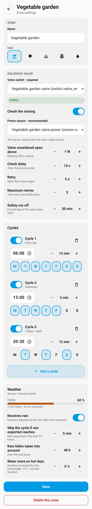
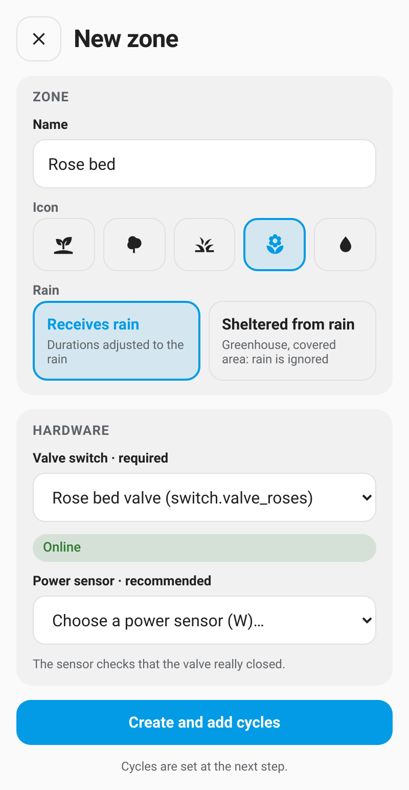
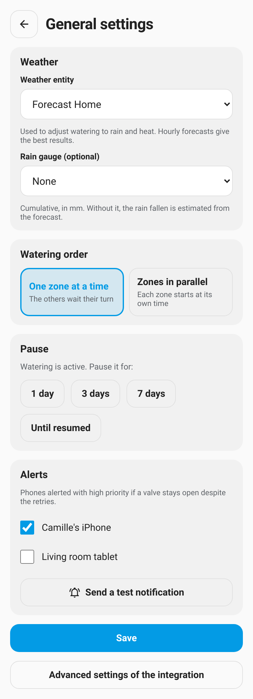

<p align="center"></p>

# hydraXoo

*[Version française](README.fr.md)*

Free and open-source zone-based irrigation for Home Assistant. Everything is set up from the user interface, with a dashboard card made for phones — no YAML.

- **Zones and cycles**: as many zones as you like, each driving an existing `switch` (Z-Wave, Zigbee, Wi-Fi plug, relay…), each with as many cycles as needed (time, duration, days).
- **Weather**: durations adjusted to rain fallen, rain expected and heat; cycles skipped when enough rain is coming.
- **Safety**: cut-off after a maximum run time, valve-closing check through the plug's power consumption, alerts on your phone if a valve stays open.
- **Card**: a dashboard, zone settings and zone creation, in light and dark themes, in English, French, German, Spanish and Italian.

<table>
  <tr>
    <td></td>
    <td></td>
    <td></td>
    <td></td>
  </tr>
  <tr>
    <td align="center">Dashboard</td>
    <td align="center">Zone settings</td>
    <td align="center">New zone</td>
    <td align="center">General settings</td>
  </tr>
</table>

## Contents

- [Requirements](#requirements)
- [Installation](#installation)
- [Getting started](#getting-started)
- [The card](#the-card)
- [Scheduling](#scheduling)
- [Weather adjustment](#weather-adjustment)
- [Safety](#safety)
- [Frost warning](#frost-warning)
- [Entities, services and events](#entities-services-and-events)
- [Automation examples](#automation-examples)
- [Troubleshooting](#troubleshooting)
- [Languages](#languages)
- [Development](#development)

## Requirements

- Home Assistant **2026.3** or newer.
- One `switch` entity per zone: the plug or relay that powers the solenoid valve.
- Recommended: the plug's **power sensor** (W), for the valve-closing check.
- Optional: a **weather** entity (Met.no, Météo-France or any other), a cumulative **rain gauge**, the **Home Assistant app** on your phone for alerts.

## Installation

hydraXoo is in the official Home Assistant Marketplace.

1. In Home Assistant, open **Settings › Marketplace**.
2. Search for **hydraXoo** and open it.
3. Install it, then **restart Home Assistant**.
4. hydraXoo is usually offered for setup right after the restart. If not: **Settings › Devices & services › Add integration › hydraXoo**.
5. **Reload the dashboard page once** so the browser loads the card.

<details>
<summary>Manual installation</summary>

Copy `custom_components/hydraxoo` from the [latest release](https://github.com/PhilGG/hydraXoo/releases) into the `custom_components` folder of your Home Assistant configuration, then restart. Updates will then also be manual.
</details>

**Updating**: install the update from the Marketplace, restart Home Assistant, then reload the dashboard page once.

**Removing**: delete the integration in **Settings › Devices & services**; its zones and history are deleted with it.

## Getting started

1. During setup, choose (all optional, changeable later from the card's ⚙ button or in **Configure › General settings**):
   - the **weather entity**;
   - a **rain sensor** (cumulative rain gauge in mm);
   - the **watering order**: *one zone at a time* (default) or *zones in parallel*;
   - the **phones** to alert if a valve cannot be closed.
2. Add the card to a dashboard: **Edit dashboard › Add card › By card › hydraXoo**.
3. In the card, select **New zone**: name, icon, *receives rain* or not, valve switch, power sensor. **Create and add cycles** then opens the zone's settings to add its cycles.

Zones can also be managed without the card, from the integration's **Configure** button.

## The card

The card is served by the integration and added to the dashboard resources automatically.

```yaml
type: custom:hydraxoo-card
title: Watering        # optional
compact: false         # optional: hides the timeline and the cycle lists
zones: []              # optional: zone ids to show, all when empty
```

These options are also available in the card's visual editor.

**Dashboard**

- Weather banner: rain fallen and expected, today's coefficient and why.
- Last valve-closing check (for example "closed after 1 retry of 5 s"), fault and pause banners.
- 24-hour timeline: finished (grey), skipped (striped), upcoming (blue), disabled (dashed), in progress (green), current time.
- One card per zone: on/off switch, next watering, today's cycles with the base duration struck through and the adjusted one (✓ Done, ✕ Skipped · rain, in 2 h…), **Water now** with a duration you choose, **Stop**, **Edit**.

**Zone settings**: valve and closing check, safety cut-off, cycles (on/off, time, duration −/+, days, add, delete), weather (receives rain, rain rules, heat bonus), **Save**, **Delete this zone**. Changes apply at once, without restarting anything.

**New zone**: name, five icons, receives rain or not, valve switch, power sensor.

**General settings** (⚙ button): weather entity and rain gauge, watering order, pause for 1, 3 or 7 days or until resumed, phones to alert — listed by name — with a **Send a test notification** button. They apply at once, without interrupting a watering. **Advanced settings of the integration** opens the Home Assistant screens.

Editing and settings are reserved to administrators; other users can water, stop and enable zones.

Times follow your profile's **time format** (12 or 24 hours) and the days follow its **first day of the week**. The time field of a cycle is the browser's own time picker: its format follows the language of your browser or phone.

## Scheduling

- A cycle starts at its time on its days if the zone and the cycle are enabled, watering is not paused, the zone is not in fault and the weather does not skip it.
- **One zone at a time** (default): a watering that comes up while another zone is watering — or while a valve is being checked — waits in a **queue** and starts as soon as the turn is free. This also applies to **Water now** and to two overlapping cycles of the same zone. **Zones in parallel**: each zone starts at its own time.
- **Pause**: the *Watering paused* switch, or `hydraxoo.pause` with a number of days (it then ends by itself). Cycles are skipped during a pause; manual watering still works and a watering in progress is not stopped. The pause survives restarts.
- **Water now** uses the duration you choose (default: the zone's first enabled cycle). Manual watering is never adjusted to the weather.
- **Disabled zone**: its cycles are skipped, manual watering still works.
- **Restart**: the queue is emptied and an interrupted cycle is not started again; a valve found open is closed and checked.

## Weather adjustment

Each zone has its own rule (card: **Edit › Weather**; or **Configure › Edit a zone › Zone settings › Weather rule**). Defaults:

| Setting | Default | Meaning |
| --- | --- | --- |
| Receives rain | on | Off for a greenhouse or a covered area: rain is ignored |
| Skip the cycle if rain expected reaches | 5 mm | Over the next 24 h; also the amount of rain that replaces a full watering |
| Rain fallen taken into account | 48 h | The last 24 h count fully, the 24 h before for half |
| Water more on hot days | +0 % | 0 % = normal duration |
| Hot day from | 30 °C | Highest temperature expected during the day |
| Minimum / maximum coefficient | 0 % / 150 % | Limits of the result |

How it is computed, right before each start:

1. **Rain expected ≥ threshold** → the cycle is skipped (event `hydraxoo_cycle_skipped`, reason `weather`).
2. Otherwise **coefficient = 1 − (rain fallen, weighted + rain expected) ÷ threshold**, between 0 and 100 %.
3. **Heat bonus**: multiplied by (1 + bonus) on hot days.
4. Kept between the minimum and the maximum; the duration is rounded to the minute. 0 minutes skips the cycle.

A zone that **does not receive rain** ignores steps 1 and 2: only the heat bonus can change its duration.

**Sources**

- **Rain expected** and **temperature**: `weather.get_forecasts`, hourly forecasts if the provider has them, otherwise daily ones. Tested with the Met.no and Météo-France formats; hours without a rain value are ignored; inches and °F are converted.
- **Rain fallen**: from the rain gauge if you set one (resets handled); otherwise estimated by recording, each hour, the forecast rain for that hour — weather entities do not report the rain actually fallen.
- **Weather unavailable**, or a provider without rain amounts: 100 % and a warning in the card and the *Weather coefficient* sensor.

## Safety

**Safety cut-off** (per zone, 5 min by default — raise it for longer cycles): the valve is always closed after this time, whatever happens. A cycle longer than the cut-off is accepted but stopped at the cut-off: the card warns about it in the zone settings (with a button to raise the cut-off) and shows ⚠ next to the real duration on the dashboard.

**Valve switched on outside hydraXoo**: valves should only be opened by hydraXoo. By default such an opening is **closed at once**, checked, shown on the card ("unexpected opening at 10:42") and sent to the chosen phones (at most one alert per zone every 10 minutes; event `hydraxoo_unexpected_open`). If you use the plug's own button on purpose, choose *Leave it open* in **General settings**: the valve then stays open until the safety cut-off, with a countdown and a Stop button on the card.

**Valve-closing check** — active when the zone has a power sensor. An open solenoid valve draws power, so after each closing hydraXoo:

1. waits the **check delay** (10 s), then reads the power;
2. at or below the **threshold** (1 W): closed;
3. above: switches the valve on for the **retry** time (5 s), off again, and goes back to step 1;
4. after the **maximum retries** (5): the zone is put in **fault**.

A zone in fault no longer waters until the fault is acknowledged (card button or `hydraxoo.acknowledge_fault`). A notification is shown in Home Assistant and, if phones are chosen in the card's **General settings › Alerts** (or **Configure › General settings › Mobile notifications**), a high-priority alert is sent to them (removed once acknowledged).

The check runs after every closing (end of watering, Stop, cut-off, valve switched off by hand), at startup, and **at any time** if a plug that is switched off starts drawing power — a stuck valve, or a plug coming back online after a restart. A plug switched on on purpose is left alone (the cut-off still applies).

**Setting up the plug**: many plugs only report their consumption periodically or after a minimum change (for example every 60 s or ±5 W). If the reading after closing predates the closing order, hydraXoo waits up to 60 s for a fresh one. For a reliable check:

1. In the plug's settings (Z-Wave JS: device configuration), lower the power **reporting interval** and the **minimum change**, as far as the plug allows.
2. Set the **check delay** a little longer than the plug's reporting interval.
3. Set the **threshold** between the plug's own idle consumption and the valve's (a solenoid valve typically draws 2 to 8 W; the threshold goes down to 0.1 W).

If the power sensor is unavailable, the closing is not checked (no retry) and a warning is logged.

## Frost warning

Outdoor pipes can burst when they freeze. When the forecast for the next 24 hours drops to **2 °C or below** (threshold adjustable; °F handled) while cycles are scheduled, hydraXoo reminds you to shut the outdoor water circuits — without nagging:

- A **frost episode** starts with the first frosty forecast and ends only when the forecast warms up clearly again (threshold + 2 °C), so a forecast hovering around the threshold does not re-trigger.
- **At most two phone notifications per episode**: the alert when frost is first forecast (deferred to 7:00 if detected at night and frost is not expected before 10:00), then **one reminder about 3 hours before the frost** if nobody confirmed — and only if it comes at least 2 hours after the alert.
- **Confirm** with the notification's **Done** or **Pause watering** buttons, or from the card's frost banner. Pausing watering, or having no enabled cycle left in frost-alerted zones, also counts as confirmed. Then nothing more until the thaw.
- The episode is saved: a restart never sends the alert again. Event `hydraxoo_frost_warning` (`kind`: `alert`, `reminder`, `thaw`).
- Optional **end-of-frost notice** (off by default), with a **Resume watering** button if watering is paused.
- Per zone, **Frost warning** can be turned off (e.g. a heated greenhouse): that zone no longer counts.

Settings: card **⚙ › Frost** (or **Configure › General settings**). Requires a weather entity; alerts go to the phones chosen under **Alerts**.

## Entities, services and events

General entities (device **hydraXoo**):

| Entity | Type | Description |
| --- | --- | --- |
| Watering paused | `switch` | When on, no cycle starts; `until` attribute when the pause ends by itself |
| Queue | `sensor` | Number of waterings waiting, listed in the `items` attribute |

Per zone (one device per zone):

| Entity | Type | Description |
| --- | --- | --- |
| Zone enabled | `switch` | When off, the zone's cycles are skipped |
| Watering | `binary_sensor` | On while hydraXoo has the valve open |
| Closing fault | `binary_sensor` (problem) | On when the valve could not be closed; last check as attributes |
| Next watering | `sensor` (timestamp) | Next start; base and adjusted duration as attributes |
| Time remaining | `sensor` (duration) | Time left in the current watering |
| Weather coefficient | `sensor` (%) | Percentage applied to the base duration; rain fallen, rain expected, temperature and warnings as attributes |

Services:

| Service | Fields |
| --- | --- |
| `hydraxoo.run_zone` | `zone` (device), `duration` (minutes, optional) |
| `hydraxoo.stop_zone` | `zone` (device) |
| `hydraxoo.stop_all` | — (also empties the queue) |
| `hydraxoo.pause` | `days` (optional; empty = until resumed) |
| `hydraxoo.resume` | — |
| `hydraxoo.acknowledge_fault` | `zone` (device) |

Events:

| Event | Data |
| --- | --- |
| `hydraxoo_cycle_started` | `zone_id`, `zone_name`, `source` (`schedule` / `manual`), `duration_min`, `cycle_id`; for cycles also `base_duration_min`, `coefficient_pct` |
| `hydraxoo_cycle_finished` | `zone_id`, `zone_name`, `reason` (`completed`, `manual_stop`, `max_runtime`, `external`, `restart`, `unload`), `source`, `duration_min`, `elapsed_min` |
| `hydraxoo_cycle_skipped` | `zone_id`, `zone_name`, `cycle_id`, `reason` (`weather`, `paused`, `zone_disabled`, `fault`, `stopped`), `weather` (details) |
| `hydraxoo_safety_retry` | `zone_id`, `zone_name`, `attempt`, `max_attempts`, `power_w` |
| `hydraxoo_safety_failed` | `zone_id`, `zone_name`, `attempts`, `power_w` |
| `hydraxoo_unexpected_open` | `zone_id`, `zone_name` |
| `hydraxoo_frost_warning` | `kind` (`alert`, `reminder`, `thaw`), `min_temp_c`, `frost_at` |

## Automation examples

Be told when rain cancels a watering:

```yaml
alias: Watering skipped because of rain
triggers:
  - trigger: event
    event_type: hydraxoo_cycle_skipped
    event_data:
      reason: weather
actions:
  - action: notify.mobile_app_my_phone
    data:
      message: "{{ trigger.event.data.zone_name }}: watering skipped, rain expected."
```

Stop everything if a leak sensor goes off, and pause for a day:

```yaml
alias: Leak - stop watering
triggers:
  - trigger: state
    entity_id: binary_sensor.garden_leak
    to: "on"
actions:
  - action: hydraxoo.stop_all
  - action: hydraxoo.pause
    data:
      days: 1
```

## Troubleshooting

| Symptom | What to do |
| --- | --- |
| The card is not offered | In **Add card**, use the **By card** tab, not *By entity*. Reload the page; check that `/hydraxoo_static/hydraxoo-card.js` is listed in **Settings › Dashboards › ⋮ › Resources**. |
| Old texts or old layout after an update | Reload the page (on a computer, force it: Ctrl/Cmd + Shift + R; in the app: *Settings › Companion app › Debugging › Reset frontend cache*). |
| Retries although the valve did close | The plug reports late: lower its reporting interval or lengthen the check delay. |
| Weather coefficient stuck at 100 % with a warning | The weather entity is unavailable, or the provider gives no rain amounts: try another provider (Met.no gives hourly amounts). |
| "—" instead of ✓ for a past cycle | No record for it (for example a cycle run before updating to 0.0.7). |

Detailed logs:

```yaml
logger:
  logs:
    custom_components.hydraxoo: debug
```

Report problems on [GitHub](https://github.com/PhilGG/hydraXoo/issues).

## Languages

English, French, German, Spanish and Italian, everywhere: setup screens, entities, services, notifications and card. The card follows the language of your Home Assistant profile (English otherwise). Translations live in `custom_components/hydraxoo/translations/` and `frontend/src/locales/`; corrections and new languages are welcome.

<!-- ha-marketplace:exclude-start -->
## Development

Everything runs in Docker; nothing else is needed on your machine.

```bash
./dev build   # build the development image
./dev test    # run the integration tests
./dev lint    # check code style
./dev card    # type-check, test and build the card (Node runs in Docker too)
./dev screenshots   # retake the README screenshots (headless Chromium in Docker)
```

The card sources are in `frontend/` (TypeScript + Lit). `custom_components/hydraxoo/frontend/hydraxoo-card.js` is generated by `./dev card`: do not edit it. See [CHANGELOG.md](CHANGELOG.md) for the history.

<!-- ha-marketplace:exclude-end -->

## License

[MIT](LICENSE)
